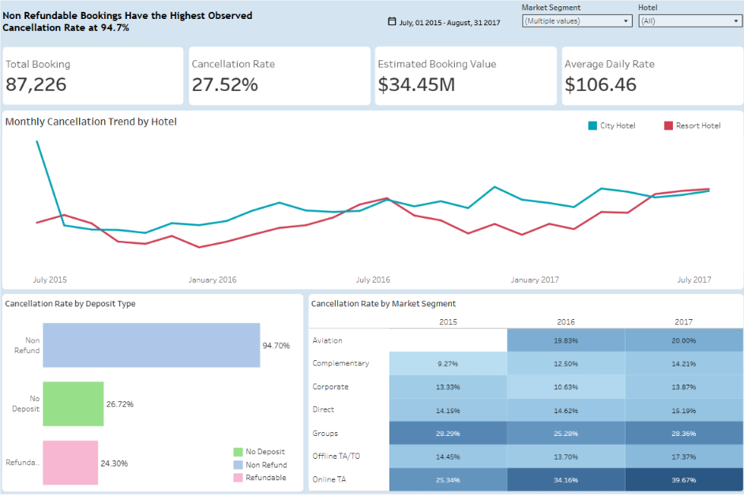

# Hotel Booking Cancellation Analysis

An independent data analysis project exploring hotel booking cancellations across deposit types, market segments, and arrival periods. Data preparation was performed in Python, followed by an interactive dashboard built in Tableau.

[View Interactive Dashboard](https://public.tableau.com/app/profile/amalia.a7093/viz/HotelBookingDashboard_17878361945630/Dashboard1)



## Project Objectives

- Compare cancellation rates across deposit types and market segments.
- Explore monthly cancellation patterns for City Hotel and Resort Hotel.
- Summarize booking volume, average daily rate, and estimated booking value.

## Dashboard Highlights

The displayed dashboard covers arrivals from July 2015 to August 2017.

| Metric | Displayed Value |
|---|---:|
| Total bookings | 87,226 |
| Cancellation rate | 27.52% |
| Estimated booking value | 34.45 million |
| Average daily rate | 106.46 |

These values reflect the filter selection shown in the dashboard preview. Interactive filter changes may produce different results.

## Key Findings

- Non-refundable bookings had the highest observed cancellation rate at **94.70%**, compared with **26.72%** for no-deposit bookings and **24.30%** for refundable bookings.
- The Online TA segment's cancellation rate increased from **25.34% in 2015** to **39.67% in 2017** in the displayed view.
- Monthly cancellation patterns differed between City Hotel and Resort Hotel.

These findings describe associations in the analyzed data and do not establish the causes of cancellation.

## Data Preparation

The notebook documents the following steps:

1. Loaded booking records from a Google Sheets CSV export.
2. Inspected data types, missing values, and duplicate rows.
3. Removed exact duplicate rows.
4. Filled missing children counts with zero and missing country values with `Unknown`.
5. Converted agent and company identifiers to strings and labeled missing entries as `None`.
6. Standardized selected categorical values.
7. Converted reservation status dates and constructed arrival dates.
8. Mapped country codes to country names using `pycountry`.
9. Created a total guest count.
10. Retained records with at least one guest and an average daily rate from 0 up to, but not including, 5,000.
11. Exported the cleaned dataset for visualization.

Duplicate removal and filtering are project preprocessing choices that affect the resulting population and metrics.

## Metric Definitions

- **Total bookings:** Count of booking records in the selected view.
- **Cancellation rate:** Canceled bookings divided by total bookings.
- **Average daily rate:** Average of the `adr` field in the selected view.
- **Estimated booking value:** Sum of `adr × (weekend nights + week nights)`.

Estimated booking value includes canceled bookings. It is not realized revenue and does not account for refunds, fees, or actual payments.

## Tools

- Python
- Pandas
- pycountry
- Tableau Public

## Repository Contents

| Path | Description |
|---|---|
| `notebooks/HotelDashboard.ipynb` | Data preparation notebook |
| `data/hotelbooking_cleaned.csv` | Cleaned dataset, if included |
| `tableau/HotelBookings.twb` | Tableau workbook |
| `images/dashboard.png` | Dashboard preview |
| `requirements.txt` | Python dependencies |

## How to Explore This Project

### Interactive dashboard

Open the Tableau Public link above and use the Hotel and Market Segment filters to explore the results.

### Notebook

The notebook was originally developed in Google Colab.

1. Open `notebooks/HotelDashboard.ipynb` in Google Colab.
2. Run the cells in order.
3. The notebook exports `hotelbooking_cleaned.csv`.

For local execution, install the dependencies:

```bash
pip install -r requirements.txt
```

Open the notebook in a Jupyter-compatible environment. Skip the final Google Colab download cell when running locally; the preceding CSV export saves the file without it.

### Tableau workbook

The `.twb` workbook references a local Excel data source named `hotelbooking_cleaned.xlsx`. It does not contain the underlying dataset.

To explore the dashboard without configuring a local data connection, use the Tableau Public link.

## Data Source

The notebook reads a hotel booking dataset from a
[Google Sheets CSV export](https://docs.google.com/spreadsheets/d/18pI_m4lTv_kOP_H7Y3weALRJB37LM7LMoj8or4YkM_g/export?format=csv).

The source URL is recorded for reproducibility. Availability and contents may change over time.

## Limitations

- Results describe the retained records after cleaning, rather than all original bookings.
- Dashboard metrics depend on the selected filters.
- Differences between booking segments do not establish causation.
- Estimated booking value should not be interpreted as actual hotel revenue.

## Author

**Amalia Azzahra**  
[GitHub](https://github.com/amalyea)